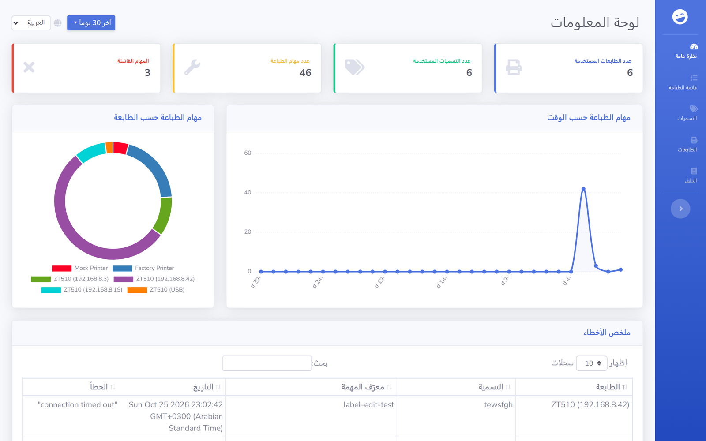
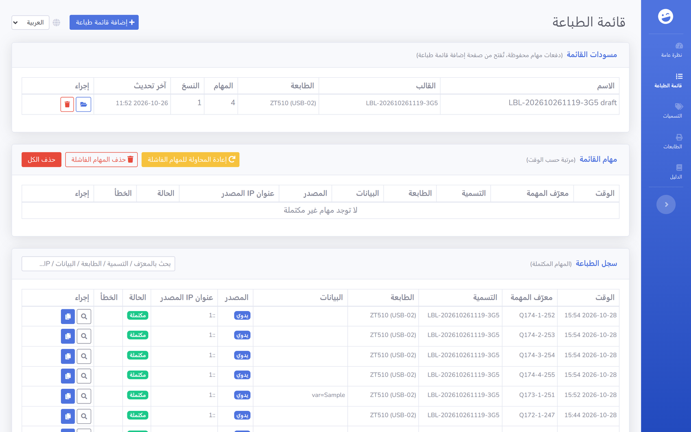
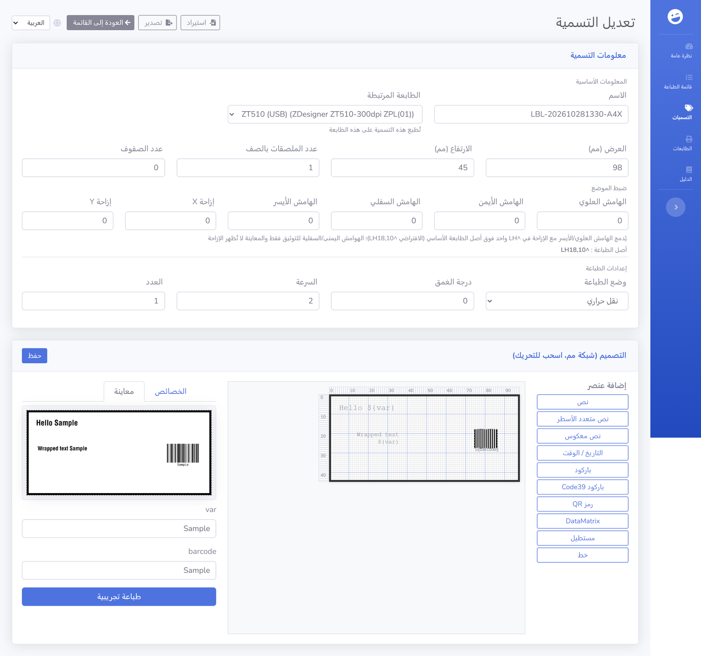
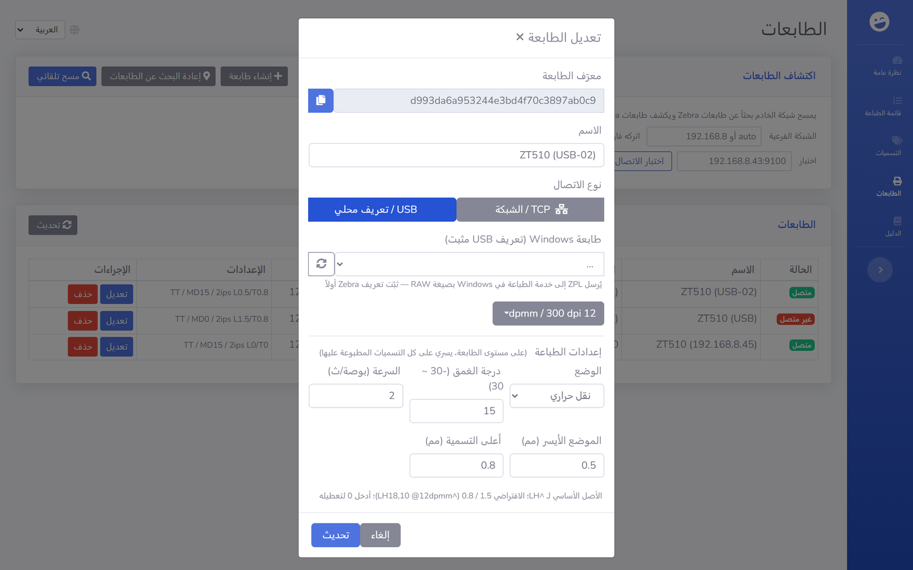

<div dir="rtl">

# zpl-rest

[English](README.md) | [简体中文](README.zh-CN.md) | **العربية**

اطبع على طابعات ملصقات Zebra من أي نظام عبر HTTP. zpl-rest خادم طباعة ذاتيّ الاستضافة: يحفظ قوالب ZPL، ويستبدل المتغيّرات بقيمها من JSON، ثم يرسل الناتج إلى الطابعة عبر الشبكة. وتعرض واجهة الويب معاينة الملصقات وإحصاءات الطباعة وسجلّ مهام الطباعة السابقة.



## لماذا zpl-rest

تقبل طابعات Zebra تعليمات ZPL الخامّة على المنفذ TCP 9100، لكن إرسالها من نظام ERP أو تطبيق مستودع أو سكربت shell يعني عادةً كتابة شيفرة socket في كل نظام على حِدة. يجمع zpl-rest هذه المهمّة في مكان واحد: يرسل تطبيقك طلب JSON قصيرًا يحمل اسم القالب والبيانات، ويتولّى zpl-rest القوالب وعناوين الطابعات وسجلّ المهام.

## المزايا

- واجهة REST API لإدارة الطابعات وقوالب ZPL
- دعم العناصر النائبة (`${varname}`) وصيغة [Mustache](https://mustache.github.io/) داخل ZPL
- محرّر ملصقات مرئي بشبكة مليمترية (نصوص، باركود، QR/DataMatrix، إطارات، خطوط، مساحات) مع معاينة محلية فورية
- ضبط دقيق لموضع الطباعة: هوامش وإزاحة على مستوى الملصق، مع نقطة أصل أساسية على مستوى الطابعة، تُجمَّع في تعليمة `^LH` واحدة — وتُظهر المعاينة التصميم كما هو دون أي إزاحة
- إعدادات طباعة لكل ملصق (نوع الوسيط / الكثافة / السرعة) مع اعتماد معايرة الطابعة المرتبطة كقيمة افتراضية
- دعم الوسائط المتعدّدة الأعمدة (تصميم واحد يُكرَّر أفقيًا في صف واحد، و`^PW` يُشتق من عرض البكرة)
- طابور طباعة مع استيراد دفعي من ملفات xlsx وإرسال متوازٍ لكل طابعة وسجلّ مهام كامل
- طابعات TCP (المنفذ الخام 9100) وطابعات Windows عبر USB (RAW عبر نظام الطباعة)، مع حالة متصل/غير متصل
- اكتشاف الطابعات في الشبكة مع تجاهل بطاقات APIPA (169.254.x)، وإعادة العثور على الطابعة بعد تغيّر عنوان DHCP
- معاينة الملصق تُولَّد بمحرّك العرض المدمج دون اتصال (zpl-renderer-js)
- طباعة تجريبية مباشرة من واجهة الويب
- سجلّ المهام مع إمكانية إعادة الطباعة، على طابعة أخرى أو بعد تعديل ZPL
- `job_id` اختياري لربط مهام الطباعة بسجلات نظامك
- خادم MCP مدمج (Streamable HTTP مع رمز Bearer) لتتمكّن أدوات الذكاء الاصطناعي من إدارة الملصقات وعرض المعاينات وبدء الطباعة
- يعمل عبر Node.js أو Docker، وتُخزَّن البيانات في ملفات JSON على القرص

## البدء السريع

### Docker

```bash
git clone https://github.com/mrothenbuecher/zpl-rest.git
cd zpl-rest
docker compose up -d
```

تكون واجهة الويب بعد ذلك على `http://localhost:8110`. وتُخزَّن الطابعات والملصقات والمهام في المجلد `./volumes` على المضيف.

### Node.js

```bash
git clone https://github.com/mrothenbuecher/zpl-rest.git
cd zpl-rest
npm install
npm start
```

تكون واجهة الويب بعد ذلك على `http://localhost:18420`.

### ملف Windows التنفيذي المحمول

بناء تطبيق Windows تنفيذي بملف واحد (دون الحاجة إلى تثبيت Node.js على الجهاز الهدف):

```bash
npm install
npm run build:win            # -> dist/zpl-rest-<yyyyMMdd-HHmm>.exe (ملف واحد)
npm run build:win:portable   # -> dist/zpl-rest-portable*/ + .zip (مجلد)
```

شكلان للتوزيع:

- **ملف exe واحد** (`build:win`) — ملف بحجم 78 ميغابايت تقريبًا، وهو الأسهل في النقل. تحذير: قد تُنهي أدوات الحماية على الأجهزة المؤسسية (لوحظ ذلك مع 云枢/YunShu) البرنامج المُغلَّف استنادًا إلى قواعد استكشافية عند مسح شبكة الطابعات، فيختفي بلا رسالة خطأ («إغلاق مفاجئ»). في هذه الحالة أضف ملف exe أو مجلده إلى قائمة الثقة، أو استخدم الحزمة المحمولة.
- **مجلد محمول** (`build:win:portable`، وهو المُوصى به للأجهزة المُدارة) — مجلد يحتوي `node.exe` الرسمي والبرنامج وتبعياته. السلوك وتخطيط البيانات متطابقان، وهو محصَّن ضد القواعد الاستكشافية. يُشغَّل عبر `启动.bat`.

شغّله بأي من الشكلين بالنقر المزدوج. عند أول تشغيل يُنشئ `config.json` (مع رمز MCP المولَّد) ومجلد بيانات `db/` **بجانب الملف التنفيذي / داخل المجلد**، لذا ضعه في مجلد قابل للكتابة. تستمع الواجهة على `http://localhost:18420` (لتغيير المنافذ راجع «الإعدادات»). محرّك Zebrash WASM مضمَّن، لذا تعمل معاينة الملصقات دون اتصال.

### أيقونة شريط النظام

عند التشغيل يفتح البرنامج واجهة الويب في المتصفح الافتراضي، ويصغّر نافذة الطرفية، ويعرض أيقونة في شريط النظام بقائمة زر الفأرة الأيمن:

- **打开主页 Open Homepage** — فتح `http://localhost:18420`
- **复制 MCP 地址 Copy MCP Address** — نسخ عنوان MCP (`http://localhost:18422/mcp`) إلى الحافظة
- **关闭服务 Close Service** — إيقاف الخادم وإزالة الأيقونة

تتبع نصوص القائمة اللغة المختارة في واجهة الويب (English / 中文 / العربية، تُحفظ في `ui_lang` داخل `config.json` وتُطبَّق فورًا دون إعادة تشغيل).

تشغيل ملف exe مرة ثانية لا يبدأ نسخة إضافية من الخادم، بل يفتح المتصفح فقط. يمكن تعطيل الميزتين في `config.json` عبر `"tray": false` / `"open_browser": false`.

## الاستخدام

### 1. إضافة طابعة

العنوان هو IP الطابعة والمنفذ الخام، ويكون عادةً 9100. أمّا density فهي دقّة الطباعة بوحدة النقطة لكل مليمتر (`6dpmm` أو `8dpmm` أو `12dpmm` أو `24dpmm`).

```bash
curl -X POST http://localhost:18420/rest/printer \
  -H "Content-Type: application/json" \
  -d '{"name": "Warehouse 1", "address": "192.168.0.50:9100", "density": "8dpmm"}'
```

### 2. إضافة قالب ملصق

يُعطى العرض والارتفاع بالمليمتر (mm).

```zpl
^XA
^LH0,0
^MTT
^A0N,36,36
^FO236,71
^FD${sometext}^FS
^XZ
```

### 3. الطباعة

```bash
curl -X POST http://localhost:18420/rest/print \
  -H "Content-Type: application/json" \
  -d '{
        "printer": "<printer id>",
        "label": "<label id>",
        "job_id": "order-4711",
        "data": { "sometext": "hello world" }
      }'
```

يستبدل zpl-rest العنصر `${sometext}` بالقيمة `hello world` ويرسل ZPL الناتج إلى الطابعة. و`job_id` اختياري: يُحفظ مع المهمة ويظهر في قائمة الإخفاقات بلوحة المعلومات وفي قسم سجلّ الطباعة بصفحة الطابور.

## موضع الطباعة

تحتوي ZPL على نقطة أصل واحدة فقط لكل تنسيق (`^LH`). يبنيها zpl-rest من مستويين، وكلاهما يُعالج بالمليمتر ويُقرَّب إلى نقاط مرة واحدة:

```
^LH = round((نقطة الأصل الأساسية للطابعة + هامش اليسار/الأعلى + الإزاحة X/Y) × dpmm)
```

- **الضبط الدقيق للملصق** (في محرّر الملصق، مجموعة «الضبط الدقيق»): أربعة هوامش صفحة بالإضافة إلى Offset X/Y، تُخزَّن في `template.page`. يؤثّر هامش اليسار/الأعلى والإزاحتان على موضع الطباعة؛ أمّا هامش اليمين/الأسفل فيُحفظ للتوثيق فقط، لأن نقطة أصل واحدة لا تستطيع سحب المحتوى من هذين الجانبين. وتُقيَّد الإزاحة بحدّ 20 مم أو ربع مقاس الملصق، أيهما أقل. وتعرض شارة للقراءة فقط في المجموعة نفسها قيمة `^LH x,y` التي ستُرسل بالضبط.
- **نقطة الأصل الأساسية للطابعة** (في إعدادات الطابعة: «موضع اليسار» و«موضع أعلى الملصق»): تعويض تحميل الوسيط الخاص بتلك الآلة، يُخزَّن في `printer.settings.base_origin_mm` ويُطبَّق على كل ملصق يُطبع عليها. القيمة الافتراضية للطابعات غير المضبوطة صراحةً هي `1.5 / 0.8 مم` (= `^LH18,10` عند 12dpmm)؛ املأ الحقلين لكل طابعة لتجاوزها، أو `0 / 0` لتعطيل هذا التعويض على تلك الآلة.
- **المعاينة تُظهر التصميم كما هو**: تُرسم معاينة الملصق دون أي من هذه الإزاحات، فما تراه هو ما رسمته بالضبط، و`^LH` المُجمَّعة تؤثّر على ناتج الطباعة فقط.

تفصيل التصميم (docs/label-page-margin.md): إحداثيات العناصر دائمًا نسبةً إلى الزاوية العلوية اليسرى الفيزيائية للملصق، وكامل الملصق هو منطقة التصميم، ولا يوجد مفهوم «منطقة آمنة».

## واجهة الويب

صفحة طابور الطباعة: استيراد دفعي من xlsx، إضافة مهمة واحدة، إدارة الطابور وسجلّ الطباعة (إعادة الطباعة تُعيد الإدراج في الطابور):



محرّر الملصقات مع المعاينة الفورية ومجموعة «الضبط الدقيق» (شارة `^LH`):



نافذة إعدادات الطابعة مع موضع الطباعة الخاص بتلك الآلة (نقطة الأصل الأساسية `settings.base_origin_mm`):



## REST API

| الطريقة | المسار | الطلب / الاستعلام | الوصف |
| ------- | ------ | ----------------- | ----- |
| GET | `/rest/printer` | لا شيء | سرد جميع الطابعات |
| GET | `/rest/label` | لا شيء | سرد جميع الملصقات |
| GET | `/rest/jobs` | لا شيء | سرد جميع مهام الطباعة |
| GET | `/rest/preview` | `?printer=<id>&label=<id>(&zpl=...)` | معاينة الملصق كصورة base64 |
| POST | `/rest/preview` | `{printer, label (, zpl)}` | معاينة الملصق كصورة base64 |
| POST | `/rest/print` | `{printer, label, data (, job_id)}` | طباعة ملصق مباشرة (دون المرور بالطابور) |
| POST | `/rest/queue/add` | `{label_id (, printer_id, data)}` | إضافة مهمة واحدة إلى طابور الطباعة (دون xlsx) |
| POST | `/rest/queue/reprint` | `{job_id \|\| item_id (, printer, zpl)}` | إعادة طباعة مهمة من السجلّ أو عنصر مكتمل في الطابور بإدراجه مجددًا، مع إمكانية تغيير الطابعة أو ZPL |
| GET | `/rest/label/variables/:labelid` | لا شيء | متغيّرات الملصق (`${var}` / `{{var}}`) |
| POST | `/rest/printer` | إضافة: `{name, address, density (, conn)}`<br>تحديث: `{_id, name, address, density (, conn, settings)}` | إضافة طابعة أو تحديثها. `conn`: ‏`"tcp"` (افتراضي) أو `"usb"` (العنوان = اسم طابعة Windows). `settings`: ‏`{mode, darkness, speed, base_origin_mm}` — معايرة الآلة (راجع «موضع الطباعة») |
| POST | `/rest/label` | إضافة: `{name, zpl, width, height}`<br>تحديث: `{_id, name, zpl, width, height}` | إضافة ملصق أو تحديثه. الملصقات المرئية تحمل `template` (العناصر + `page` للهوامش/الإزاحة اختياريًا + `roll_width_mm`) و`print_layout` (وسائط متعددة الأعمدة) بدلًا من `zpl` الخام |
| DELETE | `/rest/printer/:printerid` | لا شيء | حذف طابعة |
| DELETE | `/rest/label/:labelid` | لا شيء | حذف ملصق |

## MCP (وصول أدوات الذكاء الاصطناعي)

يأتي zpl-rest بخادم MCP (بروتوكول سياق النموذج) مدمج، لتتمكّن أدوات الذكاء الاصطناعي (WorkBuddy، Claude، Cursor، …) من تشغيل خدمة الطباعة مباشرةً: إدارة الملصقات والطابعات، توليد المعاينات، إدراج مهام الطباعة ومتابعتها.

- **العنوان**: `http://<host>:18422/mcp` (Streamable HTTP، بلا حالة)
- **التحقق**: معطّل افتراضيًا (وصول مفتوح، مخصّص للاستخدام المحلي). لطلب مفتاح، اضبط `"mcp_token": "<secret>"` في `config.json` وأرسل `Authorization: Bearer <secret>`. احفظه سرًّا، فهو يمنح صلاحية طباعة كاملة.
- تستدعي أدوات MCP واجهات REST المحلية داخليًا، لذا فالسلوك والتحقق والأحداث مطابقة تمامًا لواجهة الويب.

الأدوات: `list_labels`، `get_label`، `create_label`، `update_label`، `delete_label`، `render_preview` (أي ZPL إلى PNG)، `label_preview` (قالب محفوظ إلى PNG)، `list_printers`، `printer_status`، `print_label` (طباعة مباشرة)، `enqueue_print`، `list_queue`، `pause_queue`، `resume_queue`، `retry_failed`، `delete_queue_items`.

مثال على إعداد العميل (مثل Claude Desktop أو موصّل MCP مخصّص في WorkBuddy):

```json
{
  "mcpServers": {
    "zpl-rest": {
      "url": "http://localhost:18422/mcp",
      "headers": { "Authorization": "Bearer <mcp_token>" }  // مطلوب فقط عند ضبط mcp_token
    }
  }
}
```

## الإعدادات

تُكتب الإعدادات في `config.json` بجذر المشروع. وأي خيار تتركه فارغًا يأخذ قيمته الافتراضية.

```json
{
  "port": 18420,
  "websocket_port": 18421,
  "public": true,
  "secret": "change-me",
  "mcp_port": 18422,
  "mcp_token": "",  // فارغ = بلا تحقق؛ اضبط سرًّا لطلب تحقق Bearer
  "discovery_interval": 120  // الفاصل الزمني بين عمليات إعادة اكتشاف الطابعات (ثانية)
}
```

| الخيار | النوع | الوصف | الافتراضي |
| ------ | ----- | ----- | --------- |
| `port` | int | منفذ REST API وواجهة الويب | `18420` |
| `websocket_port` | int | منفذ WebSocket الذي تستخدمه واجهة الويب | `18421` |
| `public` | bool | عند `false` يستمع الخادم على المضيف المحلي فقط | `true` |
| `secret` | string | مفتاح الجلسة، اضبط قيمته الخاصة في بيئة الإنتاج | `top_secret` |
| `mcp_port` | int | منفذ خادم MCP (وصول أدوات الذكاء الاصطناعي) | `18422` |
| `mcp_token` | string | رمز Bearer لخادم MCP؛ تركه فارغًا يعطّل التحقق | *(فارغ)* |
| `discovery_interval` | int | الفاصل الزمني (ثانية) لإعادة الاكتشاف التلقائي لطابعات الشبكة التي تغيّر عنوان DHCP (تُعاد الطابعة إيجادها في شبكتها الفرعية عبر الرقم التسلسلي)؛ الحد الأدنى 30. ويُفعَّل أيضًا يدويًا بزر «إعادة اكتشاف الطابعات» أو عبر `POST /rest/printer/rediscover` | `120` |
| `ui_lang` | string | لغة واجهة قائمة شريط النظام، تتبع محدد اللغة في واجهة الويب (`en` / `zh` / `ar`) | `en` |

## ملاحظة الخصوصية

تُولَّد معاينات الملصقات محليًا بمحرّك ZPL المدمج (zpl-renderer-js) — فلا تغادر بيانات الملصقات الخادم ولا يُتّصل بأي خدمة خارجية. أمّا الطباعة نفسها فتنتقل مباشرةً من zpl-rest إلى طابعتك.

## الوحدات

يُتعامل مع عرض الملصق وارتفاعه بالمليمتر (mm) في كل الواجهات البرمجية وواجهة الويب. أمّا قوالب ZPL نفسها فتُستخدم فيها النقاط (dot)؛ حوّل المليمتر إلى نقاط بدقّة الطابعة بوحدة النقطة لكل مليمتر (dpmm). مثال لطابعة 8dpmm ‏(300dpi): ‏84.8 مم × 8 = 1002 نقطة، فيُكتب عرض الطباعة `^PW1002`.

## المساهمة

تقارير الأخطاء وأفكار المزايا وطلبات الدمج مرحّب بها. يُفضّل فتح issue أولًا للتغييرات الكبيرة كي نناقش المقاربة. وإذا كنت تستخدم zpl-rest في بيئة إنتاج، فملاحظة قصيرة في [Discussions](https://github.com/mrothenbuecher/zpl-rest/discussions) عن طريقة إعدادك تساعد في تحديد أولويات العمل القادم.

يمكنك أيضًا [المشاركة في هذا الاستبيان القصير](https://forms.gle/7CUv6PXQuTXQQgsR9).

## شكر وتقدير

- قالب الواجهة: [SB Admin 2](https://startbootstrap.com/themes/sb-admin-2/)
- معاينة الملصقات: [zpl-renderer-js](https://github.com/Fabrizz/zpl-renderer-js)

## دعم المشروع

[](https://www.paypal.com/cgi-bin/webscr?cmd=_s-xclick&hosted_button_id=KNC9P27TLHGDE&source=url)

## الترخيص

[MIT](LICENSE)

</div>
