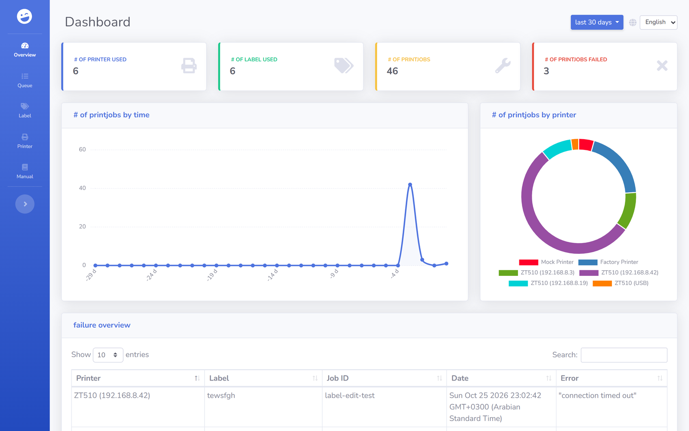
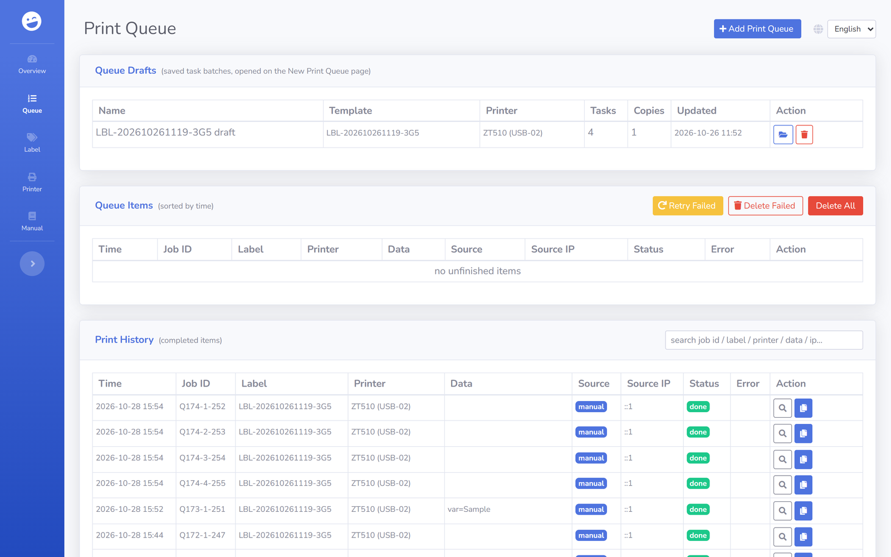
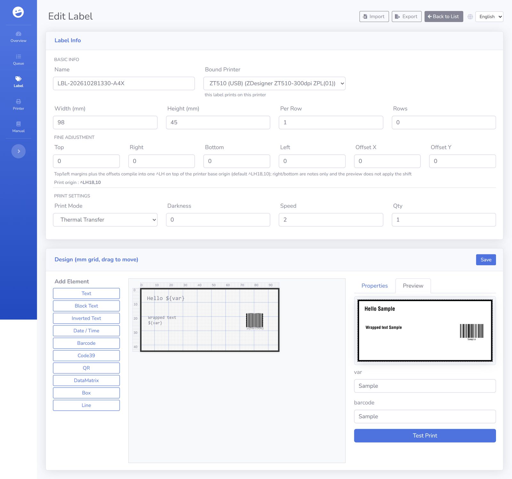
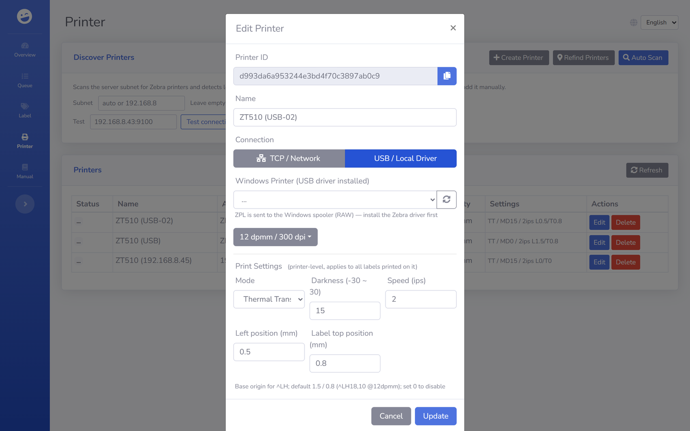

# zpl-rest

**English** | [简体中文](README.zh-CN.md) | [العربية](README.ar.md)

Print to Zebra label printers from any system via HTTP. zpl-rest is a self-hosted print server that stores your ZPL templates, fills in placeholders from JSON and sends the result to the printer over the network. A web UI shows label previews, print statistics and past print jobs.



## Why zpl-rest

Zebra printers accept raw ZPL on TCP port 9100, but sending it from an ERP, a warehouse app or a shell script usually means writing socket code in every system. zpl-rest moves that into one place. Your applications send a short JSON request with the label name and the data, and zpl-rest handles templates, printer addresses and the job history.

## Features

- REST API to manage printers and ZPL label templates
- Placeholders (`${varname}`) and [Mustache](https://mustache.github.io/) syntax inside ZPL
- Visual mm-grid label editor (text, barcodes, QR/DataMatrix, boxes, lines, blocks) with live local preview
- Print position fine adjustment: per-label margins/offset plus a per-printer base origin, compiled into a single `^LH` — previews always show the design without the shift
- Label print settings (mode / darkness / speed) per label with the bound printer's calibration as default
- Multi-column die-cut media support (one design tiled into a row, `^PW` from the roll width)
- Print queue with xlsx batch import, per-printer parallel sending and full job history
- TCP (raw 9100) and Windows USB (RAW spooler) printers, with online/offline status
- Subnet discovery that ignores APIPA (169.254.x) adapters and re-finds printers after a DHCP change
- Label preview rendered by the built-in offline ZPL renderer (zpl-renderer-js)
- Test print directly from the web UI
- Job history with reprint, optionally on a different printer or with edited ZPL
- Optional `job_id` to match print jobs with records in your own system
- Built-in MCP server (streamable HTTP + bearer token) so AI tools can manage labels, render previews and drive printing
- Runs with Node.js or Docker, data stored as JSON files on disk

## Quick start

### Docker

```bash
git clone https://github.com/mrothenbuecher/zpl-rest.git
cd zpl-rest
docker compose up -d
```

The web UI is then available at `http://localhost:8110`. Printers, labels and jobs are stored in `./volumes` on the host.

### Node.js

```bash
git clone https://github.com/mrothenbuecher/zpl-rest.git
cd zpl-rest
npm install
npm start
```

The web UI is then available at `http://localhost:18420`.

### Windows portable exe

Build a single-file Windows executable (no Node.js installation needed on the target machine):

```bash
npm install
npm run build:win            # -> dist/zpl-rest-<yyyyMMdd-HHmm>.exe (single file)
npm run build:win:portable   # -> dist/zpl-rest-portable*/ + .zip (folder)
```

Two distribution shapes:

- **Single exe** (`build:win`) — one 78 MB file, easiest to hand around. Caveat: enterprise endpoint agents (observed with 云枢/YunShu) may heuristically kill the packed binary when it runs a printer subnet scan — the process vanishes with no error ("闪退"). If that happens, add the exe / its folder to the agent's trust list, or use the portable package.
- **Portable folder** (`build:win:portable`, recommended for managed machines) — a folder with an official `node.exe`, the app and dependencies. Same behaviour and data layout, immune to the packed-binary heuristic. Start with `启动.bat`.

Run either by double-clicking. On first start it creates `config.json` (with the generated MCP token) and the `db/` data folder **next to the executable / inside the folder**, so keep it in a folder where it may write. The UI listens on `http://localhost:18420` (see Configuration to change ports). The Zebrash WASM renderer is embedded, label previews work offline.

### System tray

On start the app opens the web UI in your default browser, minimizes its console window and shows a tray icon with a right-click menu:

- **打开主页 Open Homepage** — open `http://localhost:18420`
- **复制 MCP 地址 Copy MCP Address** — copy the MCP endpoint (`http://localhost:18422/mcp`) to the clipboard
- **关闭服务 Close Service** — stop the server and remove the tray icon

The menu text follows the UI language chosen in the web UI (English / 中文 / العربية, persisted as `ui_lang` in `config.json` and applied live — no restart needed).

Launching the exe a second time does not start a duplicate server — it just opens the browser. Both features can be disabled in `config.json` with `"tray": false` / `"open_browser": false`.

## Usage

### 1. Add a printer

The address is the printer's IP and raw port, usually 9100. The density is the print resolution in dots per millimetre (`6dpmm`, `8dpmm`, `12dpmm` or `24dpmm`).

```bash
curl -X POST http://localhost:18420/rest/printer \
  -H "Content-Type: application/json" \
  -d '{"name": "Warehouse 1", "address": "192.168.0.50:9100", "density": "8dpmm"}'
```

### 2. Add a label template

Width and height are given in millimetres (mm).

```zpl
^XA
^LH0,0
^MTT
^A0N,36,36
^FO236,71
^FD${sometext}^FS
^XZ
```

### 3. Print

```bash
curl -X POST http://localhost:18420/rest/print \
  -H "Content-Type: application/json" \
  -d '{
        "printer": "<printer id>",
        "label": "<label id>",
        "job_id": "order-4711",
        "data": { "sometext": "hello world" }
      }'
```

zpl-rest replaces `${sometext}` with `hello world` and sends the finished ZPL to the printer. The `job_id` is optional. It is stored with the job and shown in the dashboard failure list and in the Print History section of the queue page.

## Print position

ZPL has exactly one origin per format (`^LH`). zpl-rest composes it from two levels, both handled in millimetres and rounded to dots once:

```
^LH = round((printer base origin + left/top margin + offset X/Y) × dpmm)
```

- **Label fine adjustment** (label editor, "Fine Adjustment" group): four page margins plus Offset X/Y, stored as `template.page`. The left/top margins and both offsets act on the print position; the right/bottom margins are kept as a note only — a single origin cannot pull content in from those two sides. Offsets are clamped to 20 mm or a quarter of the label size, whichever is smaller. A read-only badge in the same group shows the exact `^LH x,y` that will be sent.
- **Printer base origin** (printer settings, "Left position / Label top position"): that machine's media-loading compensation, stored as `printer.settings.base_origin_mm`. It applies to every label printed on that machine. The default is `1.5 / 0.8 mm` (= `^LH18,10` at 12dpmm) for printers without an explicit value; set the two fields per printer to override, or `0 / 0` to disable the compensation for that machine.
- **Previews show the design as-is**: label previews render the design without any of these shifts, so what you see is exactly what you drew — the compiled `^LH` only affects the printed output.

Design detail (docs/label-page-margin.md): element coordinates are always relative to the physical top-left corner of the label; the whole label is the design area, there is no safe-area concept.

## Web UI

Print Queue page: xlsx batch import, single job add, queue management and the print history (reprint enqueues into the queue):



Label editor with live preview and the print-position fine adjustment group (`^LH` badge):



Printer settings dialog with that machine's print position (base origin, `settings.base_origin_mm`):



## REST API

| Method | Path | Body / query | Description |
| ------ | ---- | ------------ | ----------- |
| GET | `/rest/printer` | none | List all printers |
| GET | `/rest/label` | none | List all labels |
| GET | `/rest/jobs` | none | List all print jobs |
| GET | `/rest/preview` | `?printer=<id>&label=<id>(&zpl=...)` | Label preview as base64 image |
| POST | `/rest/preview` | `{printer, label (, zpl)}` | Label preview as base64 image |
| POST | `/rest/print` | `{printer, label, data (, job_id)}` | Print a label directly (bypasses the queue) |
| POST | `/rest/queue/add` | `{label_id (, printer_id, data)}` | Add a single job to the print queue (no xlsx needed) |
| POST | `/rest/queue/reprint` | `{job_id \|\| item_id (, printer, zpl)}` | Reprint a history job or a finished queue item by enqueuing it, optionally with another printer or changed ZPL |
| GET | `/rest/label/variables/:labelid` | none | Variables (`${var}` / `{{var}}`) of a label |
| POST | `/rest/printer` | add: `{name, address, density (, conn)}`<br>update: `{_id, name, address, density (, conn, settings)}` | Add or update a printer. `conn`: `"tcp"` (default) or `"usb"` (address = Windows printer name). `settings`: `{mode, darkness, speed, base_origin_mm}` — the per-machine calibration (see Print position) |
| POST | `/rest/label` | add: `{name, zpl, width, height}`<br>update: `{_id, name, zpl, width, height}` | Add or update a label. Visual labels carry `template` (elements + optional `page` margins/offset + `roll_width_mm`) and `print_layout` (multi-column media) instead of raw `zpl` |
| DELETE | `/rest/printer/:printerid` | none | Remove a printer |
| DELETE | `/rest/label/:labelid` | none | Remove a label |

## MCP (AI tool access)

zpl-rest ships a built-in MCP (Model Context Protocol) server so AI tools (WorkBuddy, Claude, Cursor, ...) can drive the printing service directly: manage labels and printers, render previews, enqueue and monitor print jobs.

- **URL**: `http://<host>:18422/mcp` (Streamable HTTP, stateless)
- **Auth**: off by default (open access, intended for localhost use). To require a key, set `"mcp_token": "<secret>"` in `config.json` and send `Authorization: Bearer <secret>`. Keep it secret; it grants full print access.
- The MCP tools call the local REST endpoints internally, so behaviour, validation and events are identical to the web UI.

Tools: `list_labels`, `get_label`, `create_label`, `update_label`, `delete_label`, `render_preview` (arbitrary ZPL to PNG), `label_preview` (stored template to PNG), `list_printers`, `printer_status`, `print_label` (direct print), `enqueue_print`, `list_queue`, `pause_queue`, `resume_queue`, `retry_failed`, `delete_queue_items`.

Example client configuration (e.g. Claude Desktop / WorkBuddy custom MCP connector):

```json
{
  "mcpServers": {
    "zpl-rest": {
      "url": "http://localhost:18422/mcp",
      "headers": { "Authorization": "Bearer <mcp_token>" }  // only needed if mcp_token is set
    }
  }
}
```

## Configuration

Settings go into `config.json` in the project root. Any option you leave out uses its default.

```json
{
  "port": 18420,
  "websocket_port": 18421,
  "public": true,
  "secret": "change-me",
  "mcp_port": 18422,
  "mcp_token": "",  // empty = no auth; set a secret to require Bearer auth
  "discovery_interval": 120  // seconds between automatic printer re-find scans
}
```

| Option | Type | Description | Default |
| ------ | ---- | ----------- | ------- |
| `port` | int | Port for the REST API and web UI | `18420` |
| `websocket_port` | int | WebSocket port used by the web UI | `18421` |
| `public` | bool | If `false`, the server only listens on localhost | `true` |
| `secret` | string | Session secret, set your own value in production | `top_secret` |
| `mcp_port` | int | Port for the MCP server (AI tool access) | `18422` |
| `mcp_token` | string | Bearer token for the MCP server; empty disables auth | *(empty)* |
| `discovery_interval` | int | Seconds between automatic re-find scans for network printers whose DHCP address changed (the printer is re-found in its subnet by serial number); minimum 30. Also triggered manually via the "Refind Printers" button or `POST /rest/printer/rediscover` | `120` |
| `ui_lang` | string | UI language for the tray right-click menu, follows the language selector in the web UI (`en` / `zh` / `ar`) | `en` |

## Privacy note

Label previews are rendered locally by the built-in ZPL renderer (zpl-renderer-js) — no label data ever leaves the server and no external service is contacted. Printing itself goes directly from zpl-rest to your printer.

## Units

Label width and height are handled in millimetres (mm) throughout the API and web UI. ZPL templates themselves use dots; convert mm to dots with the printer density in dots per mm (dpmm). Example for an 8dpmm (300dpi) printer: 84.8 mm x 8 = 1002 dots, printed width `^PW1002`.

## Contributing

Bug reports, feature ideas and pull requests are welcome. Please open an issue first for larger changes so we can discuss the approach. If you use zpl-rest in production, a short note in [Discussions](https://github.com/mrothenbuecher/zpl-rest/discussions) about your setup helps to decide what to work on next.

You can also [take part in this short survey](https://forms.gle/7CUv6PXQuTXQQgsR9).

## Credits

- Frontend template: [SB Admin 2](https://startbootstrap.com/themes/sb-admin-2/)
- Label previews: [zpl-renderer-js](https://github.com/Fabrizz/zpl-renderer-js)

## Support the project

[](https://www.paypal.com/cgi-bin/webscr?cmd=_s-xclick&hosted_button_id=KNC9P27TLHGDE&source=url)

## License

[MIT](LICENSE)
