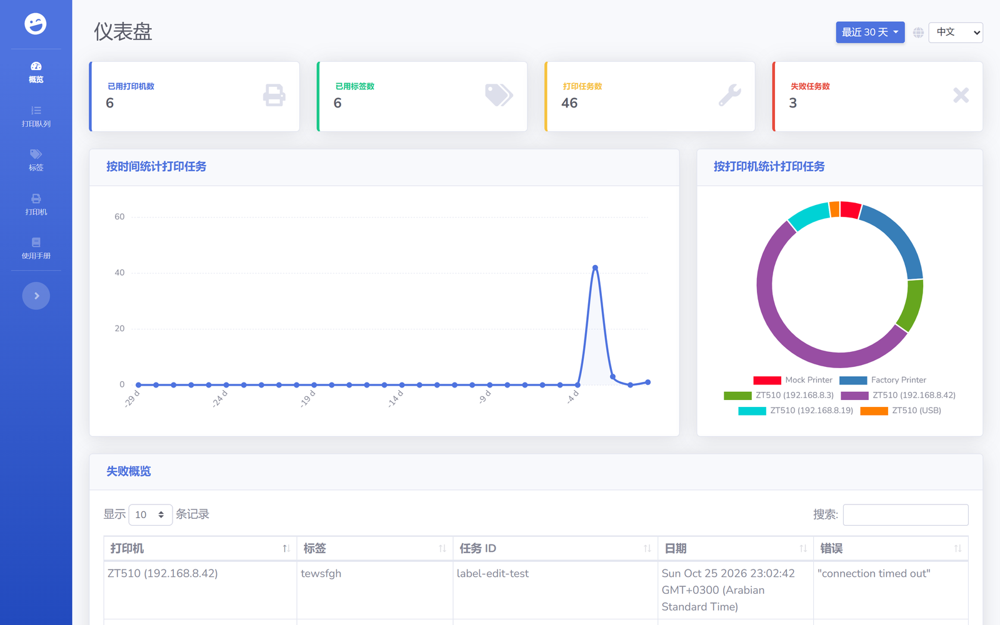
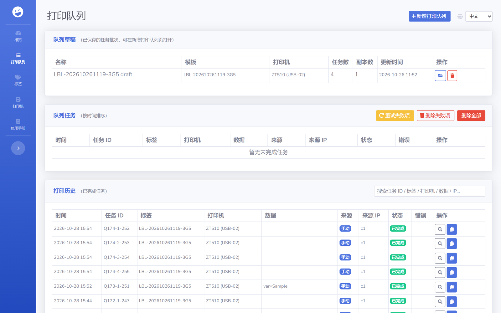
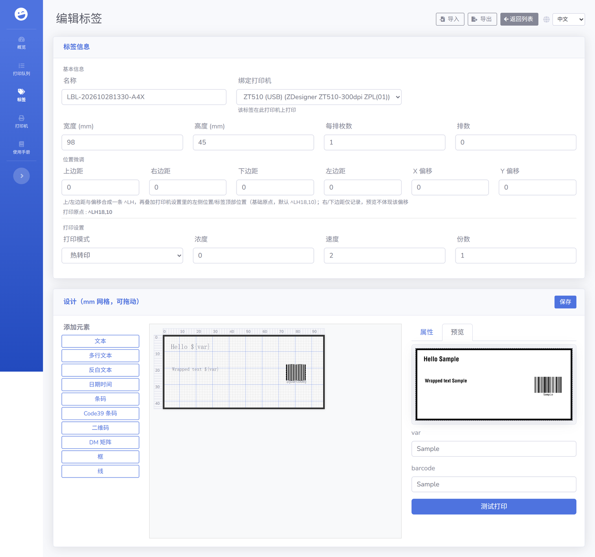
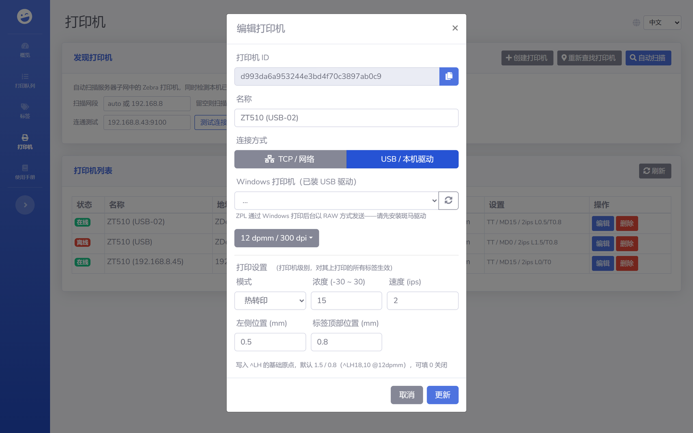

# zpl-rest

[English](README.md) | **简体中文** | [العربية](README.ar.md)

通过 HTTP 从任意系统打印到 Zebra 标签打印机。zpl-rest 是一个自托管的打印服务：它保存你的 ZPL 模板，把 JSON 里的变量填进模板，再把结果通过网络发送给打印机。网页界面提供标签预览、打印统计和历史打印任务。



## 为什么需要 zpl-rest

Zebra 打印机在 TCP 9100 端口接受裸 ZPL，但从 ERP、仓储应用或 shell 脚本里发送 ZPL，通常意味着每个系统都要自己写一套 socket 代码。zpl-rest 把这部分收拢到一处。你的应用只需要发一个简短的 JSON 请求，带上标签名和数据，模板、打印机地址和任务历史都由 zpl-rest 负责。

## 功能特性

- REST API 管理打印机与 ZPL 标签模板
- ZPL 内支持占位符（`${varname}`）和 [Mustache](https://mustache.github.io/) 语法
- 毫米网格可视化标签编辑器（文本、条码、QR/DataMatrix、方框、线条、色块），本地实时预览
- 打印位置微调：标签级边距/偏移，加上打印机级基础原点，编译成单个 `^LH`——预览始终只显示设计本身，不含位移
- 标签级打印设置（介质方式 / 浓度 / 速度），默认套用所绑定打印机的校准值
- 支持多列模切介质（一份设计横向平铺成一排，`^PW` 由卷宽决定）
- 打印队列：xlsx 批量导入、按打印机并行发送、完整任务历史
- 支持 TCP（裸 9100）与 Windows USB（后台 RAW）打印机，并带在线/离线状态
- 网段发现会跳过 APIPA（169.254.x）网卡，DHCP 地址变化后仍能重新找到打印机
- 标签预览由内置离线渲染器（zpl-renderer-js）生成
- 可直接在网页上测试打印
- 任务历史支持重打，可换用其它打印机或修改 ZPL
- 可选 `job_id`，把打印任务与你系统内的记录对应起来
- 内置 MCP 服务器（streamable HTTP + Bearer 令牌），AI 工具可管理标签、渲染预览并直接驱动打印
- 可用 Node.js 或 Docker 运行，数据以 JSON 文件形式存放在磁盘上

## 快速开始

### Docker

```bash
git clone https://github.com/mrothenbuecher/zpl-rest.git
cd zpl-rest
docker compose up -d
```

随后网页界面位于 `http://localhost:8110`。打印机、标签和任务数据保存在宿主机的 `./volumes` 目录。

### Node.js

```bash
git clone https://github.com/mrothenbuecher/zpl-rest.git
cd zpl-rest
npm install
npm start
```

随后网页界面位于 `http://localhost:18420`。

### Windows 便携 exe

构建单文件 Windows 可执行程序（目标机器无需安装 Node.js）：

```bash
npm install
npm run build:win            # -> dist/zpl-rest-<yyyyMMdd-HHmm>.exe（单文件）
npm run build:win:portable   # -> dist/zpl-rest-portable*/ + .zip（文件夹）
```

两种分发形态：

- **单文件 exe**（`build:win`）——一个约 78 MB 的文件，最方便传递。注意：企业终端防护软件（实测云枢/YunShu）在程序执行打印机网段扫描时，可能按启发式规则杀掉加壳二进制，进程无声消失（“闪退”）。遇到这种情况，把 exe 或其所在目录加入防护软件信任列表，或改用便携包。
- **便携文件夹**（`build:win:portable`，受管电脑推荐）——一个包含官方 `node.exe`、程序本体和依赖的文件夹。行为与数据布局完全一致，且不受加壳启发式规则影响。用 `启动.bat` 启动。

双击即可运行。首次启动会在**可执行文件同级目录 / 文件夹内部**创建 `config.json`（含自动生成的 MCP 令牌）和 `db/` 数据目录，因此请把它放在有写权限的目录里。界面监听 `http://localhost:18420`（端口修改见“配置”）。Zebrash WASM 渲染器已内嵌，标签预览可离线工作。

### 系统托盘

启动后程序会用默认浏览器打开网页界面、最小化控制台窗口，并在托盘显示一个右键菜单：

- **打开主页 Open Homepage** —— 打开 `http://localhost:18420`
- **复制 MCP 地址 Copy MCP Address** —— 把 MCP 端点（`http://localhost:18422/mcp`）复制到剪贴板
- **关闭服务 Close Service** —— 停止服务并移除托盘图标

菜单文字跟随网页界面中选择的语言（English / 中文 / العربية，以 `ui_lang` 持久化在 `config.json`，实时生效，无需重启）。

重复启动 exe 不会启动第二个服务实例——它只会打开浏览器。这两项功能都可以在 `config.json` 中用 `"tray": false` / `"open_browser": false` 关闭。

## 使用方法

### 1. 添加打印机

地址是打印机的 IP 和裸端口，通常是 9100。density 是打印分辨率，单位是每毫米点数（`6dpmm`、`8dpmm`、`12dpmm` 或 `24dpmm`）。

```bash
curl -X POST http://localhost:18420/rest/printer \
  -H "Content-Type: application/json" \
  -d '{"name": "Warehouse 1", "address": "192.168.0.50:9100", "density": "8dpmm"}'
```

### 2. 添加标签模板

宽和高以毫米（mm）为单位。

```zpl
^XA
^LH0,0
^MTT
^A0N,36,36
^FO236,71
^FD${sometext}^FS
^XZ
```

### 3. 打印

```bash
curl -X POST http://localhost:18420/rest/print \
  -H "Content-Type: application/json" \
  -d '{
        "printer": "<printer id>",
        "label": "<label id>",
        "job_id": "order-4711",
        "data": { "sometext": "hello world" }
      }'
```

zpl-rest 会把 `${sometext}` 替换成 `hello world`，并把完整的 ZPL 发给打印机。`job_id` 是可选项，会随任务一起保存，并显示在仪表盘的失败列表和队列页的打印历史中。

## 打印位置

ZPL 每份格式只有一个原点（`^LH`）。zpl-rest 从两个层级合成它，全部按毫米处理，只取整一次：

```
^LH = round((打印机基础原点 + 左/上边距 + 偏移 X/Y) × dpmm)
```

- **标签位置微调**（标签编辑页“位置微调”分组）：四个页边距加 Offset X/Y，存放在 `template.page`。左/上边距和两个偏移参与打印定位；右/下边距仅作记录——单一原点无法从这两个方向把内容拉进来。偏移会被钳位到 20 mm 或标签尺寸的四分之一（取较小值）。同一分组内有一个只读徽标，显示将要发送的 `^LH x,y` 精确值。
- **打印机基础原点**（打印机设置的“左侧位置 / 标签顶部位置”）：该机器的介质装载补偿，存放在 `printer.settings.base_origin_mm`，对该机器上打印的每个标签生效。未显式配置的打印机默认 `1.5 / 0.8 mm`（12dpmm 下即 `^LH18,10`）；按台填写这两个字段即可覆盖，填 `0 / 0` 则对该机器关闭这项补偿。
- **预览显示未位移的设计**：标签预览渲染时不带上述任何位移，所见即所画——编译出的 `^LH` 只影响实际打印输出。

设计细节见（docs/label-page-margin.md）：元素坐标始终相对标签物理左上角；整张标签就是设计区域，没有安全区概念。

## 网页界面

打印队列页：xlsx 批量导入、单条任务添加、队列管理与打印历史（重打会重新入队）：



带实时预览与「位置微调」分组（`^LH` 徽标）的标签编辑器：



打印机设置弹窗，含该机的打印位置（基础原点 `settings.base_origin_mm`）：



## REST API

| 方法 | 路径 | 请求体 / 查询参数 | 说明 |
| ---- | ---- | ----------------- | ---- |
| GET | `/rest/printer` | 无 | 列出全部打印机 |
| GET | `/rest/label` | 无 | 列出全部标签 |
| GET | `/rest/jobs` | 无 | 列出全部打印任务 |
| GET | `/rest/preview` | `?printer=<id>&label=<id>(&zpl=...)` | 标签预览，返回 base64 图片 |
| POST | `/rest/preview` | `{printer, label (, zpl)}` | 标签预览，返回 base64 图片 |
| POST | `/rest/print` | `{printer, label, data (, job_id)}` | 直接打印一张标签（绕过队列） |
| POST | `/rest/queue/add` | `{label_id (, printer_id, data)}` | 向打印队列添加一条任务（无需 xlsx） |
| POST | `/rest/queue/reprint` | `{job_id \|\| item_id (, printer, zpl)}` | 以入队方式重打历史任务或已完成的队列项，可换打印机或修改 ZPL |
| GET | `/rest/label/variables/:labelid` | 无 | 标签中的变量（`${var}` / `{{var}}`） |
| POST | `/rest/printer` | 新增：`{name, address, density (, conn)}`<br>更新：`{_id, name, address, density (, conn, settings)}` | 新增或更新打印机。`conn`：`"tcp"`（默认）或 `"usb"`（地址填 Windows 打印机名）。`settings`：`{mode, darkness, speed, base_origin_mm}` —— 该机的校准参数（见“打印位置”） |
| POST | `/rest/label` | 新增：`{name, zpl, width, height}`<br>更新：`{_id, name, zpl, width, height}` | 新增或更新标签。可视化标签用 `template`（元素 + 可选 `page` 边距/偏移 + `roll_width_mm`）和 `print_layout`（多列介质）替代裸 `zpl` |
| DELETE | `/rest/printer/:printerid` | 无 | 删除打印机 |
| DELETE | `/rest/label/:labelid` | 无 | 删除标签 |

## MCP（AI 工具接入）

zpl-rest 内置 MCP（Model Context Protocol）服务器，AI 工具（WorkBuddy、Claude、Cursor……）可以直接驱动这套打印服务：管理标签和打印机、渲染预览、入队并监控打印任务。

- **地址**：`http://<host>:18422/mcp`（Streamable HTTP，无状态）
- **认证**：默认关闭（开放访问，适用于本机使用）。如需密钥，在 `config.json` 中设置 `"mcp_token": "<secret>"`，请求时带上 `Authorization: Bearer <secret>`。请妥善保管，它等同于完整打印权限。
- MCP 工具内部调用本机 REST 接口，因此行为、校验和事件与网页界面完全一致。

工具列表：`list_labels`、`get_label`、`create_label`、`update_label`、`delete_label`、`render_preview`（任意 ZPL 转 PNG）、`label_preview`（已存模板转 PNG）、`list_printers`、`printer_status`、`print_label`（直接打印）、`enqueue_print`、`list_queue`、`pause_queue`、`resume_queue`、`retry_failed`、`delete_queue_items`。

客户端配置示例（如 Claude Desktop / WorkBuddy 自定义 MCP 连接器）：

```json
{
  "mcpServers": {
    "zpl-rest": {
      "url": "http://localhost:18422/mcp",
      "headers": { "Authorization": "Bearer <mcp_token>" }  // 仅在设置了 mcp_token 时需要
    }
  }
}
```

## 配置

配置写在项目根目录的 `config.json`。未填写的选项使用默认值。

```json
{
  "port": 18420,
  "websocket_port": 18421,
  "public": true,
  "secret": "change-me",
  "mcp_port": 18422,
  "mcp_token": "",  // 留空 = 不认证；填值则要求 Bearer 认证
  "discovery_interval": 120  // 自动重新发现打印机的间隔（秒）
}
```

| 选项 | 类型 | 说明 | 默认值 |
| ---- | ---- | ---- | ------ |
| `port` | int | REST API 与网页界面端口 | `18420` |
| `websocket_port` | int | 网页界面使用的 WebSocket 端口 | `18421` |
| `public` | bool | 为 `false` 时服务只监听本机 | `true` |
| `secret` | string | 会话密钥，生产环境请改成自己的值 | `top_secret` |
| `mcp_port` | int | MCP 服务器端口（AI 工具接入） | `18422` |
| `mcp_token` | string | MCP 服务器的 Bearer 令牌；留空则不认证 | *（空）* |
| `discovery_interval` | int | 自动重新发现 DHCP 地址变化的网络打印机的间隔（秒）；按其子网、以序列号重新找到打印机；最小 30。也可用“重新发现打印机”按钮或 `POST /rest/printer/rediscover` 手动触发 | `120` |
| `ui_lang` | string | 托盘右键菜单的界面语言，跟随网页界面的语言选择（`en` / `zh` / `ar`） | `en` |

## 隐私说明

标签预览由内置 ZPL 渲染器（zpl-renderer-js）在本地生成——标签数据不会离开服务器，也不会联系任何外部服务。打印本身由 zpl-rest 直接发往你的打印机。

## 单位

API 与网页界面中的标签宽高统一以毫米（mm）表示。ZPL 模板本身使用点（dot）；按打印机分辨率（每毫米点数，dpmm）把毫米换算成点。以 8dpmm（300dpi）打印机为例：84.8 mm × 8 = 1002 点，打印宽度写 `^PW1002`。

## 开发笔记

项目现状、设计契约、技术债与下一轮路线图见 [docs/PROJECT-STATE.md](docs/PROJECT-STATE.md)。改动打印位置、队列调度或打印机发现之前，请先读这份文档。

## 许可证

[MIT](LICENSE)
