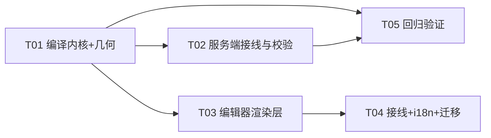
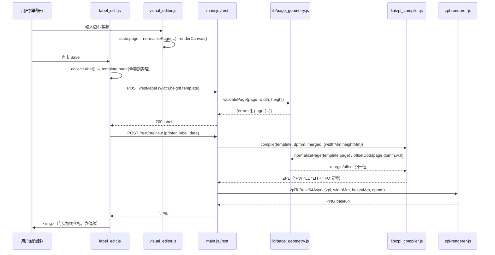

# 标签页页边距与打印原点：技术路线（施工图）

> 目标：让 `/label/edit` 的设计结果在实物上与预览图一致，并把「页边距 / 安全区 / 打印偏移」固化成数据模型 + 编译规则 + 坐标系契约。
> 单位约定：设计层全部 mm，ZPL 内部全部 dot，按打印机 `dpmm` 用 `dot(mm, dpmm) = Math.round(mm * dpmm)` 换算（沿用 `lib/zpl_compiler.js`）。

---

## 0.3 2026-10-28 变更：打印机基础原点（默认 ^LH18,10）+ 预览含边距

现场标定（`LBL-202610281050-879` 满幅框）确认每台打印机有一个固定的**装机原点补偿**，它属于打印机而不属于标签。落地为三层合成：

```
^LH = round( (base_origin_mm + margin.left + offset.x) * dpmm ) ,
      round( (base_origin_mm.y + margin.top + offset.y) * dpmm )
```

- **默认基础原点**：`DEFAULT_BASE_ORIGIN_MM = {x:1.5, y:0.8}`（12dpmm = `^LH18,10`），对**所有未显式配置的打印机**生效（`main.js` 常量，前端 `label_edit.js` 徽标同值兜底）。
- **按台覆盖**：`printer.settings.base_origin_mm = {x, y}`（mm，REST 写入；POST `/rest/printer` 白名单已放行该字段），填 `{x:0,y:0}` 可把某台钉回 `^LH0,0`。当前 USB-01 已显式写入 1.5/0.8。
- 879 标签的 `template.page` 已清零（接口对全零 page 直接不落盘）——`^LH18,10` 完全来自打印机基础原点。
- **预览画布 = 标签 + 四边页边距**（`getPreview`：宽 = `width + left + right`，高 = `height + top + bottom`），ZPL 原样渲染——上/左边距把内容推进画布，右/下边距表现为对应侧的留白，`^LH`（含基础原点）的位移在预览中真实可见，不再被标签尺寸裁掉。
- **可视化画布不变**：仍是 `width × height` 的标签本体。
- 端到端验证：mock 打印机（无显式 base）经真实队列收到的 ZPL 带 `^LH18,10`；`zpl_compiler_page_test` 新增 4 断言（默认合成 / 与 margin 叠加 2.5mm→30 dots / 无 opts 不变 / 非法 base 降级）。

## 0.2 2026-10-28 变更（定稿，覆盖 §0.1 的界面部分）：取消「安全区」概念

操作者的心智模型只有一句：**标签尺寸就是全部可布置区域**，页边距和偏移只是**打印位置的微调**。因此「安全区」从 UI、校验、编译器里彻底退场：

- **没有安全区**：标签 `width × height` 的每一平方毫米都能放元素。画布不画内框、不画灰化、不判越界；右侧属性面板不再有「超出安全区」警告；新元素落点固定 `5,5`（小标签按尺寸收缩）。
- **页边距 + 偏移 = 微调量，合成为一条 `^LH`**：`^LH = (margin.left + offset.x, margin.top + offset.y)`，按 `min(20mm, size/4)` 在 **mm 层** 钳位后一次性换算成 dot。ZPL 只有一个原点，所以**只有上/左边距能作用到输出**；右/下边距保留在数据里作记录，永不进 ZPL。
- **校验放宽**：服务端只拒绝「偏移单独超限」（`offset out of range`），**边距再大也不会 400**——合成值超限时钳位并给 warning。客户端 blur 时把左边距/上边距钳到 `0..limit`、偏移钳到 `±limit`、右边距/下边距只保证 `>= 0`。
- **老模板默认值改为 0**：无 `page` 的标签归一化为全零页（原先是 `margin_mm = 1mm×4`，那时 margin 不进 ZPL 所以无害；现在 margin 参与输出，1mm 会给所有老标签加隐式位移）。
- **几何 API**：`lib/page_geometry.js` 用 `shiftMm()` / `originDots()` 取代 `offsetDots()`，`safeArea()` 删除。前端 `visualEditorApi` 新增 `getShift()` 供 `^LH` 徽标读数。
- i18n：三语各 343 key，删 `le.safe_area` / `le.out_of_safe` / `le.err_margin_too_big`，`le.group_page` 改为「位置微调」。

§0.1 的「参数在卡片、画布只画标签、预览只画标签区域」仍然有效；§0.1 里「margin 不进 ZPL」「安全区读数」「客户端校验边距合计」已被本节作废。§2–§4 的 `^PW/^LL` 规则仍然有效，`^LH` 的取值口径以本节为准。

---

## 0.1 2026-10-28 变更：控制项放在标签信息卡片，画布只留标签尺寸

当天先做过一版「界面完全不暴露边距/偏移」，试用后改为现在的形态——**参数回到标签信息卡片，画布只显示标签本身**：

- **参数面板**：标签信息卡片里恢复「页面」分组：4 个边距输入框 + Offset X/Y，以及只读反馈「安全区 W × H」和 `^LH x,y` 徽标（都随输入实时换算，偏移按 `min(20mm, size/4)` 钳位、blur 回填）。保存前仍做客户端校验（边距合计、偏移范围），服务端 `validatePage` 是最终权威。
- **可视化画布只显示标签尺寸**：画布 = `width × height` 的标签本体，不画纸带、不画安全区虚线框、不画原点标记；标尺 0 点仍是标签物理左上角。越界提示改为纯文字（右侧属性面板的琥珀色小字），不再在画布上套琥珀边框。新元素落点仍在安全区内。
- **预览图只画标签区域**：`getPreview()` 画布宽取 `label.width`（不再按 `page.roll_width_mm` 撑到纸宽）。84.8mm 标签在 98mm 纸带上时预览是 1018×286 dots，而不是 1176×286。
- **数据与编译规则不动**：`template.page` 照旧保存与编译，`^PW/^LL/^LH` 顺序与优先级不变，存量标签的 `roll_width_mm`（黄色小标 84.8）和 `offset_mm` 照旧生效；`margin_mm` 仍只是设计期约束、不进 ZPL。
- i18n：三语各 346 key，键集合一致（比 §8 少一个没被引用的 `le.offset`）。

§5 描述的页面面板位置与 `ve-safe-area` / `ve-lh-badge` 读数仍然有效，只是画布内的安全区虚线框与原点标记不再绘制；§2–§4 的数据模型与编译规则完全有效。

---

## 0. 三个关键决策（先看这三条）

| # | 决策 | 内容 |
|---|------|------|
| D1 | **坐标系契约** | 元素 `x_mm / y_mm` **永远相对标签物理左上角**（`[0,width] × [0,height]`，整张标签都是可布置区域）。唯一写进 ZPL 的位移量是 `margin.left/top + offset_mm` 的合成值（→ `^LH`）；右/下边距仅记录。*（2026-10-28 定稿，见 §0.2；原文为「margin 只是设计期安全区、不进 ZPL」）* |
| D2 | **`^LH` 归属层级** | `^LH` 只在**标签级**出现，一个格式**只发一次**，位于第一条 `^FO` 之前。做**纸面物理偏移**补偿，**不平铺、不按列复制**（多列 `shiftElement` 只改 `x_mm`，不动 `^LH`）。 |
| D3 | **老模板默认值** | 无 `page` 字段的模板 → 归一化为全零页 → `^LH0,0`，元素坐标逐字节不变。*（2026-10-28 起不再迁移成 `1mm×4`：margin 参与输出后那 1mm 会变成隐式位移，存量标签保持全零即可）* |

---

## 1. 根因与修复对照

| 根因 | 现象 | 修复 | 落点 |
|------|------|------|------|
| a) 无 `^PW`/`^LL` | 打印机按自身校准长度（ZT510 实测 `zpl.label_length=301` dots）排版，与设计 285.6 dots 差 15 dots ≈ 1.25mm，纵向整体错位，连打累积 | 每个格式发 `^PW`(标签/行宽) + `^LL`(标签高) | `lib/zpl_compiler.js: compile()` |
| b) 无 `^LH`（恒 `^LH0,0`） | 纸在介质导轨下的左右/上下装纸偏差无法吸收，内容整体偏 | `^LH = offset_mm × dpmm`（可正可负） | `compile()` + `template.page.offset_mm` |
| c) 设计层无安全区 | 元素贴边即出血，实物边缘被裁 | 编辑器画安全区虚线 + 出血灰化 + 越界警示 + 新元素默认落在安全区内 | `html/js/visual_editor.js` |
| d) 预览只画设计坐标 | 屏上「齐边」很漂亮，纸上不齐 | 预览渲染的是**含 `^PW/^LL/^LH` 的同一份 ZPL**（`getPreview` 路径不变），画布 = 标签尺寸 → 屏幕即实物 | 无需改渲染，改的是编译输出 |

实测基线（改前，12dpmm，84.8×23.8）：

```
^XA
^MTT
^MD15
^PR2
^LH0,0
^FO0,0^A0N,48,48^FDEDGE^FS
^PQ1
^XZ
```

改后（同一模板，`page.offset_mm={x:0,y:0}`）——这就是 T01 的验收样本：

```
^XA
^MTT
^MD15
^PR2
^PW1018      ← 84.8 × 12 = 1017.6 → 1018 dots（恰等于该打印机 sgd print_width）
^LL286       ← 23.8 × 12 = 285.6  → 286 dots（不再是 301）
^LH0,0
^FO0,0^A0N,48,48^FDEDGE^FS
^PQ1
^XZ
```

---

## 2. 数据模型：`label.template.page`

```json
{
  "elements": [ { "type": "text", "props": { "x_mm": 5, "y_mm": 5, "height_mm": 3, "content": "Hello ${var}" } } ],
  "print_settings": { "mode": "thermal_transfer", "darkness": 0, "speed": 2, "quantity": 1 },
  "page": {
    "margin_mm": { "top": 1, "right": 1, "bottom": 1, "left": 1 },
    "offset_mm": { "x": 0, "y": 0 },
    "roll_width_mm": 84.8
  }
}
```

字段定义：

| 字段 | 类型 | 默认 | 含义 | 是否进 ZPL |
|------|------|------|------|-----------|
| `page.margin_mm.top/right/bottom/left` | number ≥ 0，mm，2 位小数 | `0` | **安全区**：内容建议边界。四向独立 | ❌ 不写 |
| `page.offset_mm.x` | number，mm，可负 | `0` | 打印内容整体**水平**位移；**正 = 向右** | ✅ `^LH x` |
| `page.offset_mm.y` | number，mm，可负 | `0` | 打印内容整体**纵向**位移；**正 = 向下**（走纸方向） | ✅ `^LH y` |
| `page.roll_width_mm` | number > 0，mm，**可选** | 缺省 | 卷材物理宽度，覆盖 `^PW`（多列平铺在更宽卷上时用） | ✅ `^PW`（优先级最高） |

- 命名沿用项目既有 `*_mm` 后缀约定（与 `x_mm / height_mm / thickness_mm` 一致）。
- `page` **缺省合法**；`page` 全零（且无 `roll_width_mm`）时前端 `getTemplate()` **不落盘**，保持老 JSON 干净、diff 最小。
- **不做打印机级 page**：`label.printer_id` 已经把标签绑定到一台打印机（现网 4 个标签全部绑定），偏移是「这台打印机 + 这张标签」的组合量；放在标签级既够用又避免引入 label×printer 交叉表。打印机密度/校准仍在 `db/printer.json`。

---

## 3. 编译规则（公式写死）

在 `lib/zpl_compiler.js` 的 `compile(template, dpmm, settingsOverride, opts)` 内，`^MD/^PR` 之后、首条 `^FO` 之前，**按此顺序**发三条（顺序固定，便于快照测试）：

```
^PW<pwDots>
^LL<llDots>
^LH<lhX>,<lhY>
```

```js
var page   = pageGeometry.normalizePage(template.page);   // 纯函数，见 §6
var dpmm   = dpmm || 8;
var widthMm  = Number(opts.widthMm)  || 0;   // labelToZpl 传入（新）
var heightMm = Number(opts.heightMm) || 0;   // labelToZpl 传入（新）
var cols     = Math.max(1, parseInt(opts.repeatCols, 10) || 1);

// --- ^PW 优先级：roll_width_mm  >  多列 rowWidthMm  >  单标签 widthMm ---
var pwMm = page.roll_width_mm
        || (cols > 1 && Number(opts.rowWidthMm) > 0 ? Number(opts.rowWidthMm) : widthMm);
if (pwMm > 0)                 zpl += '^PW' + dot(pwMm, dpmm) + '\n';   // 无 widthMm 的老调用方 → 不发（行为不变）
if (heightMm > 0)             zpl += '^LL' + dot(heightMm, dpmm) + '\n';

var lh = pageGeometry.offsetDots(page, dpmm, widthMm || 84.8, heightMm || 23.8); // 先 mm 钳制，再取整
zpl += '^LH' + lh.x + ',' + lh.y + '\n';                                // 始终发，替换原 ^LH0,0
```

规则要点：

1. **`^PW` 与既有 `print_layout` 多列的关系**：现状 `cols>1` 时发 `^PW = dot(rowWidthMm)`（`main.js: rowBaseZpl()` 传 `rowWidthMm = label.width * cols`）。**保持这一优先级不变**，只在最前面加一个显式覆盖 `page.roll_width_mm`。
   - 冲突处理：三者不会同时生效，`^PW` 只发一次；多列时**不允许**退化成 `label.width`（那会把第 2、3 列裁掉）。
   - ⚠️ 现场待确认（重要）：黄色小标 `LBL-202610261119-3G5`（22×5，`cols=3`）现在发 `^PW792`（66mm），第三列字段落在 579+264=843 dots（=70.25mm）→ **超出 ^PW，被裁 4.25mm**。若该卷真实宽度是 84.8mm（`test/calib_yellow_3col.js` 的默认卷宽就是 84.8），给该标签配 `page.roll_width_mm = 84.8` 即可修正 `^PW`（`^PW1018`）。列间距 `stepMm` 若为真实 pitch（≈29.33mm）而非 `label.width`，属 `print_layout` 改造范围，本次**不改**，仅记录风险。
2. **`^LL`**：恒等于 `dot(label.height, dpmm)`。`opts.heightMm` 缺失（老单测直接调 `compile`）时**不発**，保证旧断言不变。
3. **`^LH` 替换关系**：原代码 `zpl += '^LH0,0\n'` 被替换为公式；`offset = 0` 时输出仍是 `^LH0,0`（逐字节等价）。
4. **`^LH` 只发一次、位于所有 `^FO` 之前**；多列 `shiftElement` 只在 `x_mm` 上加 `stepMm * c`，**绝不**参与 `^LH`。
5. 取整只发生一次：坐标各自 `dot()`（不变），偏移单独 `dot()`，**不把 offset 加进元素坐标再取整**（避免每元素独立舍入导致的列间 ±1 dot 抖动）。
6. `compileElement()` / `shiftElement()` / `collectVariables()` **签名与行为全部不变**。

---

## 4. 坐标系契约（写死，四处对齐）

> **唯一约定：元素 `x_mm/y_mm` 的原点 = 标签物理左上角；`margin_mm` 是「建议别越过这里」的软约束；`offset_mm` 是「整张内容整体挪一点」的物理补偿。**

为什么这样定（而不是「坐标相对安全区」）：

- 老模板 4 个标签的元素 min x 已到 4.25mm、min y 到 1.25mm；若改成安全区相对，等于给全部存量模板加了一次隐式位移 → 直接打破「老模板完全不变」。
- 多列平铺时，每列的「安全区原点」各不相同，但 `^LH` 只能发一次（整卷一个原点）→ 安全区相对坐标系与多列在数学上冲突。
- 预览的画布就是「标签尺寸」；只有标签相对坐标才能让「预览 = 纸面」在含 `^LH` 时依然成立。

四处实现一致性（这是最容易出错的地方，逐处写死）：

| 处 | 文件 | 做法 |
|----|------|------|
| 编辑器渲染/拖动 | `html/js/visual_editor.js` | 元素 `left = x_mm*SCALE`、`top = y_mm*SCALE`，相对画布左上角；拖动钳制 `[0,width]×[0,height]`（**不变**）。安全区只画虚线框/灰化出血区。 |
| 编译器 | `lib/zpl_compiler.js` | `^FO = dot(x_mm)`，**不加** margin、**不加** offset；offset 只进 `^LH`。 |
| 预览 | `main.js: getPreview()` | **零改动**：画布 `label.width × label.height`，`dpmm = printer.density`，渲染同一份 ZPL。 |
| 多列平铺 | `lib/zpl_compiler.js: shiftElement()` | 只 `x_mm += stepMm * c`，与 margin/offset 无关。 |

推论（验收用）：
- 元素 `x_mm = 0` 依然表示**贴标签左边缘**（可以出血，只是编辑器会警示）。
- `offset_mm.x = +1` 时，实物内容比改前右移 1mm，预览图里也会右移 1mm（同一个 `^LH`）→ 屏幕与实物同步，方向唯一。
- 标定口诀：**offset = 预览位置 − 实物位置**（实物偏左 1mm 就填 `+1`）。

---

## 5. 编辑器 UX

### 5.1 页面面板（`views/label_edit.ejs`，基本信息卡片内、尺寸行之后）

新增分组 `<h6 data-i18n="le.group_page">页面</h6>`，一行 6 个输入（`col-lg-2`）：

| 控件 id | 标签 key | 默认 | 约束 |
|---------|----------|------|------|
| `#ve-margin-top` | `le.margin_top` | 0 | ≥0，step 0.1 |
| `#ve-margin-bottom` | `le.margin_bottom` | 0 | ≥0 |
| `#ve-margin-left` | `le.margin_left` | 0 | ≥0 |
| `#ve-margin-right` | `le.margin_right` | 0 | ≥0 |
| `#ve-offset-x` | `le.offset_x` | 0 | ±20 且 ≤ width/4 |
| `#ve-offset-y` | `le.offset_y` | 0 | ±20 且 ≤ height/4 |

- 分组下方 `<small class="text-muted" data-i18n="le.page_hint">`（契约说明）+ `le.offset_hint`（方向说明）。
- (P1，可选) `#ve-roll-width` 对应 `page.roll_width_mm`，占位显示"按标签宽"，留空即不写。
- 只读显示：`安全区 82.8 × 21.8 mm`（i18n `le.safe_area`），以及 `^LH 0,0` 徽标（i18n `le.print_origin`），让人一眼看到实际补偿量。

### 5.2 画布（`html/js/visual_editor.js` + `html/css/custom.css`）

1. **安全区虚线 + 出血灰化**：在 `#ve-canvas` 内追加
   ```html
   <div class="ve-safe" style="left:1mm*S; top:t*S; right:r*S; bottom:b*S"></div>
   ```
   ```css
   .ve-safe { position:absolute; border:1px dashed #e74a3b;
              box-shadow: 0 0 0 9999px rgba(120,120,120,.12); pointer-events:none; }
   #ve-canvas { overflow: hidden; }   /* 让 9999px 阴影只灰化标签内、安全区外 */
   ```
   一层 box-shadow 就把「出血区」灰化掉，无需 4 个 div。
2. **mm 标尺**：`#ve-canvas-wrap` 上方/左侧各一条 `#ve-ruler-top` / `#ve-ruler-left`，`background: repeating-linear-gradient(...)` 画 1mm 细线 + 5mm 中线 + 10mm 粗线，每 10mm 叠加数字（JS 循环 `<span>`，`SCALE = 4px/mm`）。
3. **打印原点标识**：画布左上角画十字（`.ve-origin`），并在页面面板显示 `^LH x,y` 徽标。
4. **越界高亮（软约束）**：元素若 `x < margin.left || y < margin.top || x > W-margin.right || y > H-margin.bottom` → 外框 `#f6c23e`（琥珀），属性面板顶部加一行 `⚠ 超出安全区`（`le.out_of_safe`）。**不阻止保存**，避免老模板一打开就红一片。
5. **新元素默认落点**：`x = min(max(5, margin.left), W - margin.right - 1)`，`y` 同理（margin=0 时仍是 `5,5`，与现状一致）。
6. **RTL 修正**（必须）：`#ve-canvas { direction: ltr; }` —— ar 语言下画布坐标永远是物理左→右，不能跟着 `dir=rtl` 翻。
7. **拖动/输入钳制**：拖动 `Math.max(0, Math.min(W, ...))` 保持现状；属性面板 `x_mm/y_mm` 输入同样按标签边界钳制。

### 5.3 读写接口

```js
// visual_editor.js
state.page = { margin_mm: {top:0,right:0,bottom:0,left:0}, offset_mm: {x:0,y:0} };

function getTemplate() {                      // page 全零 → 省略
  var t = { elements: ..., print_settings: ... };
  if (!isEmptyPage(state.page)) t.page = clonePage(state.page);
  return t;
}
function loadTemplate(t) { state.page = normalizePage(t.page); /* 缺省 → 全零 */ }
window.visualEditorApi.setPage = function (p) { state.page = normalizePage(p); renderCanvas(); notify(); };
window.visualEditorApi.getPage = function () { return clonePage(state.page); };
```

`label_edit.js`：`loadLabel()` 把 `l.template.page` 填进 6 个输入框；输入 `input/change` → `setPage()` + `notify()`；`collectLabel()` 收集 → 客户端校验（§6）→ 全零则不写 `page`。`import/export` 同步带上 `page`。

---

## 6. 边界与校验

### 6.1 纯函数模块 `lib/page_geometry.js`（新建）

```js
'use strict';
function num(v, d) { v = Number(v); return isFinite(v) ? v : d; }
function round2(v) { return Math.round(v * 100) / 100; }

var ZERO = { top: 0, right: 0, bottom: 0, left: 0 };

function normalizePage(page) {                 // 永不出错，永远返回合法对象
  page = page || {};
  var m = page.margin_mm || {}, o = page.offset_mm || {};
  var out = {
    margin_mm: { top: round2(Math.max(0, num(m.top, 0))), right: round2(Math.max(0, num(m.right, 0))),
                 bottom: round2(Math.max(0, num(m.bottom, 0))), left: round2(Math.max(0, num(m.left, 0))) },
    offset_mm: { x: round2(num(o.x, 0)), y: round2(num(o.y, 0)) }
  };
  var rw = num(page.roll_width_mm, 0);
  if (rw > 0) out.roll_width_mm = round2(rw);
  return out;
}

function isEmptyPage(page) {
  var p = normalizePage(page);
  return !p.roll_width_mm && !p.margin_mm.top && !p.margin_mm.right &&
         !p.margin_mm.bottom && !p.margin_mm.left && !p.offset_mm.x && !p.offset_mm.y;
}

function safeArea(page, wMm, hMm) {
  var m = normalizePage(page).margin_mm;
  return { x_mm: m.left, y_mm: m.top,
           width_mm:  Math.max(0.1, round2(wMm - m.left - m.right)),
           height_mm: Math.max(0.1, round2(hMm - m.top  - m.bottom)) };
}

function offsetDots(page, dpmm, wMm, hMm) {    // 先按 mm 钳制，再一次取整
  var o = normalizePage(page).offset_mm;
  var limX = Math.min(20, wMm / 4), limY = Math.min(20, hMm / 4);
  var clamp = function (v, lim) { return Math.max(-lim, Math.min(lim, v)); };
  return { x: Math.round(clamp(o.x, limX) * dpmm), y: Math.round(clamp(o.y, limY) * dpmm) };
}

function validatePage(page, wMm, hMm) {        // 服务端权威校验
  var errors = [], warnings = [], p = normalizePage(page);
  if (wMm > 0 && p.margin_mm.left + p.margin_mm.right >= wMm - 0.5)
    errors.push('margins exceed label width');
  if (hMm > 0 && p.margin_mm.top + p.margin_mm.bottom >= hMm - 0.5)
    errors.push('margins exceed label height');
  if (Math.abs(p.offset_mm.x) > Math.min(20, wMm / 4) || Math.abs(p.offset_mm.y) > Math.min(20, hMm / 4))
    errors.push('offset out of range');
  if (p.margin_mm.left + p.margin_mm.right > wMm * 0.8) warnings.push('margins leave little printable area');
  return { errors: errors, warnings: warnings, page: p };
}
module.exports = { normalizePage, isEmptyPage, safeArea, offsetDots, validatePage };
```

判定逻辑：

| 场景 | 处理 |
|------|------|
| `page` 缺失 / `null` | 视为全零，**不发错**，输出与今天一致 |
| 非数字 / `NaN` / `undefined` | `num()` 回落 `0` |
| 负数 margin | `Math.max(0, …)` 静默钳到 0（服务端归一化时）；前端输入框 `min="0"` |
| 小数 | 保留 2 位（4 位以上的噪声截掉）；`dot()` 在最后一步才取整 |
| `left+right ≥ width-0.5` 或 `top+bottom ≥ height-0.5` | 服务端 `400` + `le.err_margin_too_big`；前端 toastr 拦截、**不算保存成功** |
| offset 超范围（>±20mm 或 >标签尺寸/4） | 服务端 `400` + `le.err_offset_range`；前端 blur 时静默钳回边界并提示 |
| offset 极值导致内容出纸 | 预览照实显示（`^LH` 负值让内容顶到纸外），**不额外拦截** |
| `type = zpl_raw` | 完全不走本模型，`page` 不适用（表单隐藏） |

---

## 7. 存量 4 个标签的迁移值

| 标签 | 尺寸 / dpmm | `print_layout` | 元素范围（实测） | 迁移 `page` |
|------|------------|----------------|------------------|-------------|
| Element Palette Test | 100×60 / 12 | cols 1 | min x 5, min y 2, max x 65, max y 50.5 | `margin 1mm×4`, `offset 0,0` |
| LBL-202610252329-0T7 | 84.8×23.8 / 12 | cols 1 | 单 block @ 5,5 30×3 | `margin 1mm×4`, `offset 0,0`（+ 观察 `^LL286` 是否已消除 1.25mm 纵向差；残留用 `offset.y` 补） |
| LBL-202610260906-K89 | 100×45 / 12 | cols 1 | min x 5, min y 3.75, max x 82.25, max y 41 | `margin 1mm×4`, `offset 0,0` |
| LBL-202610261119-3G5（黄色小标） | 22×5 / 12 | **cols 3** | 单 text @ 4.25,1.25（高 4 → 触底 5.25，存量设计已溢出 0.25mm） | `margin 1mm×4`, `offset 0,0`, **`roll_width_mm` 待现场确认**（若卷宽 84.8 就填 84.8，固定 `^PW1018`；否则留空沿用 `^PW792`） |

迁移执行方式（**绝不改 `db/*.json`**）：

1. **默认值兜底**（立即生效，零写盘）：`normalizePage()` 对无 `page` 的模板返回全零 → 编译输出 = 今天 + `^PW/^LL`。
2. **打开即落地**（推荐）：用户在编辑器打开并保存时，6 个输入框的初值预填 `1/1/1/1`（仅当 `page` 完全缺失时），保存即写入。
3. **脚本兜底**（可选，`scripts/migrate_page.js`）：默认 `--dry-run` 只打印将改动的标签；必须显式 `--write` 且 `process.env.ZPL_DATA_DIR` 指向隔离目录才允许写，服务运行中直接拒跑（检测 `ZPL_DATA_DIR` 未设置即 `exit 1`）。

因为 margin 不进 ZPL，迁移对**打印输出是 no-op**：唯一真实变化是 `^PW/^LL`（bug 修复本身），可以放心批量。

---

## 8. i18n 新增 key（zh / en / ar 各 +16，三语数量必须一致）

现网 `html/js/locales/{zh,en,ar}.js` 各 **257** 个 key，改造后各 **273** 个（脚本校验：`grep -c "^\s*'[^']*':"` 三文件相等）。

| key | zh | en | ar |
|-----|----|----|----|
| `le.group_page` | 页面 | Page | الصفحة |
| `le.margin` | 页边距 (mm) | Page margins (mm) | هوامش الصفحة (مم) |
| `le.margin_top` | 上 | Top | أعلى |
| `le.margin_bottom` | 下 | Bottom | أسفل |
| `le.margin_left` | 左 | Left | يسار |
| `le.margin_right` | 右 | Right | يمين |
| `le.offset` | 打印偏移 (mm) | Print offset (mm) | إزاحة الطباعة (مم) |
| `le.offset_x` | X 偏移 | Offset X | إزاحة X |
| `le.offset_y` | Y 偏移 | Offset Y | إزاحة Y |
| `le.safe_area` | 安全区 | Safe area | المنطقة الآمنة |
| `le.print_origin` | 打印原点 | Print origin | أصل الطباعة |
| `le.out_of_safe` | 超出安全区 | Outside safe area | خارج المنطقة الآمنة |
| `le.page_hint` | 安全区只作设计参考，不改变输出坐标 | The safe area only guides the design and does not change coordinates | المنطقة الآمنة للتصميم فقط ولا تغيّر الإحداثيات |
| `le.offset_hint` | 写入 ^LH，正 X 向右、正 Y 向下 | Emitted as ^LH; positive X moves right, positive Y moves down | تُكتب في ^LH؛ X موجب إلى اليمين و Y موجب إلى الأسفل |
| `le.err_margin_too_big` | 页边距合计超出标签尺寸 | Margins exceed the label size | مجموع الهوامش يتجاوز أبعاد الملصق |
| `le.err_offset_range` | 打印偏移超出允许范围 | Print offset out of range | إزاحة الطباعة خارج النطاق المسموح |

---

## 9. 任务分解（≤5 个，按依赖排序）

### T01 编译内核与几何纯函数（P0，无依赖）
- 文件：`lib/page_geometry.js`（新建）、`lib/zpl_compiler.js`（`compile()` 新增 `^PW/^LL/^LH`；`require('./page_geometry.js')`）、`test/page_geometry_test.js`（新建）、`test/zpl_compiler_page_test.js`（新建）
- 改动点：§3 公式 + §6.1 模块；`compileElement/shiftElement/collectVariables` **不动**
- 可单测：`normalizePage`/`isEmptyPage`/`safeArea`/`offsetDots`/`validatePage`；`compile()` 字符串断言（含 `opts.widthMm` 缺失时不发 `^PW/^LL` 的旧行为）

### T02 服务端接线与保存校验（P0，依赖 T01）
- 文件：`main.js`、`test/api_label_page_test.js`（新建）、`docs/label-page-margin.md`（落地记录）
- 改动点：`labelToZpl()` 合并 `{widthMm: label.width, heightMm: label.height}` 进 `opts`（**必须保留 `rowBaseZpl` 传入的 `repeatCols/stepMm/rowWidthMm`**，用浅拷贝合并而非覆盖）；`POST /rest/label` 对 `template.page` 走 `validatePage()` → `errors[0]` 时 `res.status(400).send(...)`，否则 `normalizePage()` 后回写，`isEmptyPage()` 则 `delete template.page`
- 单测：`ZPL_DATA_DIR` 指向临时目录起服务，断言 400/200、`page` 归一化结果、`getPreview` 返回 PNG

### T03 编辑器渲染层（P0，依赖 T01 的契约常量；可与 T02 并行）
- 文件：`views/label_edit.ejs`（页面分组 6 输入 + 标尺节点 + `<style>`）、`html/js/visual_editor.js`（`state.page`、`setPage/getPage`、安全区/灰化/标尺/原点/越界高亮/新元素落点/`direction:ltr`）、`html/css/custom.css`（`.ve-safe`、`.ve-ruler`、`.ve-origin`、琥珀越界）
- 单测点：手工 —— 改 margin 后虚线框位置、改 offset 后徽标数值、ar 语言下画布不翻转、拖到 0 仍可（仅变色）

### T04 编辑器接线 + i18n + 迁移（P0，依赖 T03）
- 文件：`html/js/label_edit.js`、`html/js/locales/zh.js`、`html/js/locales/en.js`、`html/js/locales/ar.js`、`scripts/migrate_page.js`（新建，dry-run 默认）
- 改动点：`loadLabel` 回填 6 输入（`page` 缺失时预填 1/1/1/1）、`collectLabel` 客户端校验 + 全零不落盘、`import/export` 带 `page`；16 个 key ×3
- 校验点：三语 key 数相等；保存后 `db` 里 `template.page` 结构正确（用隔离 `ZPL_DATA_DIR` 验证）

### T05 回归验证与文档收敛（P1，依赖 T01/T02，对应团队任务 #3）
- 文件：`test/label_page_regression_test.js`（新建）、`CHANGES.md`、`docs/label-page-margin.md`
- 内容：4 个真实模板快照（84.8×23.8 → `^PW1018/^LL286`；100×60 → `^PW1200/^LL720`；100×45 → `^PW1200/^LL540`；22×5 cols=3 → `^PW792/^LL60` 且三列 `^FO` 51/315/579 不变）；无 `page`+无 `opts.widthMm` 时输出与旧版**逐字节一致**；`offset 1.5,-1` → `^LH18,-12`

依赖图：



---

## 10. 调用流（编译 + 预览）



打印路径（`rowBaseZpl` → `print_queue`）与预览**共用同一个 `labelToZpl`**，所以测试打印与预览必然一致；多列时 `rowBaseZpl` 已负责把 `rowWidthMm` 传进 `opts`。

---

## 11. 风险与明确不做

**风险**
1. `^LL` 在带间隙（非连续）介质上可能被传感器/校准覆盖；若改后仍残留 ~1mm 纵向差，用 `offset_mm.y` 兜底（`zpl.label_length=301` 与 286 的 15 dots 差应由此消除，但需实测一次）。
2. 负 `^LH` 的渲染器兼容性需实测一次（`zpl-renderer-js` 已验证支持 `^LH` 平移；负值仅影响内容出界，非报错）。
3. 多列 `^PW` 小于物理卷宽会裁剪（黄色小标，见 §3 第 1 条）→ 用 `page.roll_width_mm` 兜底，**不擅自改 `print_layout` 语义**。
4. 前端 `clamp/round` 与 `lib/page_geometry.js` 逻辑重复（无构建、无模块化，无法共享）→ 服务端为唯一权威，前端只做体验；同一套常量写进注释，防漂移。
5. `margin_mm` **不改变输出**，用户可能期待「填了边距内容自动内缩」→ 靠 `le.page_hint` 文案 + 安全区虚线 + 越界警示来传达，属产品表达风险。

**明确不做**
- 不做打印机级 page 配置（`db/printer.json` 不加字段）。
- 不做「打印机不可打印边缘」的裁剪模拟（预览不画机器裁剪；只能靠 margin 约束设计）。
- 不改 `print_layout`（`cols/rows`）语义，不改多列 `stepMm` 取值。
- 不改 `type=zpl_raw` 路径（手写 ZPL 用户自己做 `^PW/^LL/^LH`）。
- 不引入前端依赖 / 构建步骤（jQuery + Bootstrap 4 现成栈）；不打包（不跑 `scripts/build_win*.js`）。
- 不修改 `db/*.json`（迁移走读时兜底 + 保存时落盘 + 隔离目录脚本）。
- 不给元素加「相对安全区」的第二种坐标系（唯一契约见 §4）。

---

## 12. 2026-10-28 追加：位置微调回归标签页，预览不带偏移

三轮调整后的最终形态（覆盖 §10 的预览描述）：

1. **打印机设置**（新建/编辑弹窗）新增「左侧位置 / 标签顶部位置」两个 mm 输入，
   写 `printer.settings.base_origin_mm {x,y}`——这是**基础原点**（装机补偿），
   默认 1.5 / 0.8mm = ^LH18,10 @12dpmm（`main.js DEFAULT_BASE_ORIGIN_MM`），
   填 0 可按台关闭。
2. **标签编辑页恢复「位置微调」组**：4 个页边距 + Offset X/Y + `^LH` 徽标
   （徽标 = 标签位移 + 该机基础原点，含默认值兜底）。保存时经
   `visual_editor.getTemplate()` 写回 `template.page`（全零 page 不落盘）。
3. **预览不体现打印偏移**：`getPreview` 画布恒为标签本体（width × height），
   预览 ZPL 由 `labelToZpl(label, printer, {previewOrigin: true})` 编译——
   基础原点与 margin/offset 在预览编译时全部归零（`roll_width_mm` 保留，
   仍是 ^PW 来源）。预览 = 设计原样；打印 = 设计 + ^LH 位移，两者分离。
   手写 ZPL（`req.body.zpl` / `req.query.zpl`）不归零，按原样渲染。

^LH 合成不变：`^LH = round((base.x + margin.left + offset.x) × dpmm)`（y 同理），
mm 层合并后一次取整；右/下边距仍仅记录、永不进 ZPL。
